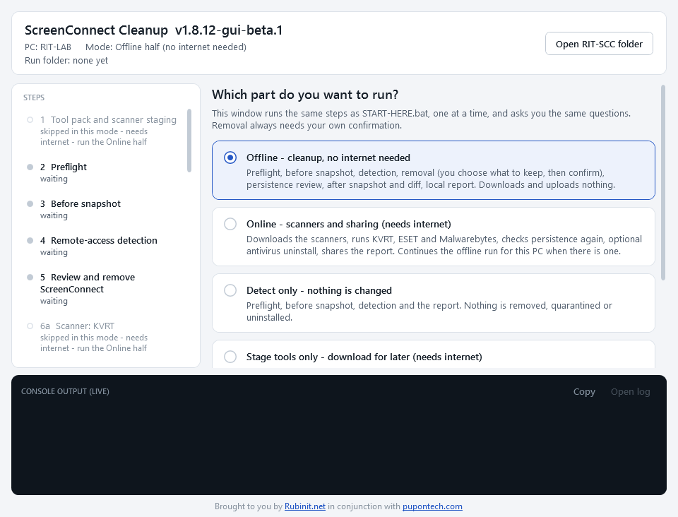
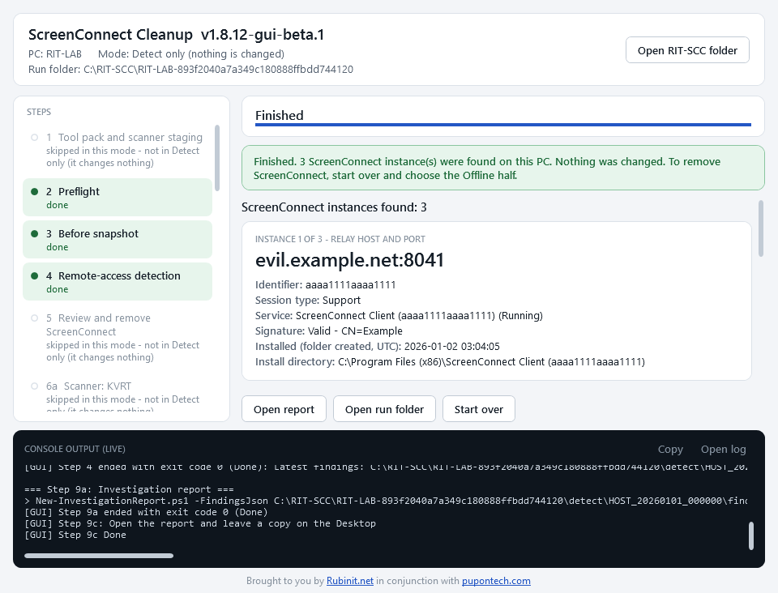
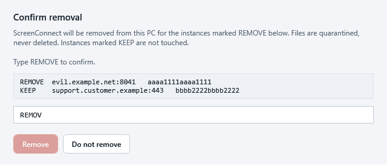

# ScreenConnect Cleanup

A Windows technician tool for PCs where a scammer got remote access through ScreenConnect. It usually
gets there from an **invite email the user clicked** (a fake invoice, meeting or "document shared with
you"), which installs ScreenConnect connected to the scammer's server.

**Antivirus will not catch it.** ScreenConnect is a legitimate, signed program that IT companies use
every day, so no AV treats it as a virus. This tool finds every ScreenConnect instance, shows **which
relay server each one calls home to** (the only reliable way to tell the scammer's copy from the
customer's own IT), removes the ones you choose, checks what else was left behind to start up with
Windows, runs the AV scanners for any other malware, and writes a report.

---

```powershell
irm https://raw.githubusercontent.com/pupontech/screenconnect-cleanup/main/install-latest.ps1 | iex
```

Read [`install-latest.ps1`](install-latest.ps1) first if you prefer; it only downloads, verifies,
extracts and launches. Running it again with the same version just opens the existing copy.

**Needs:** Windows 10 or 11, an administrator account (the launcher asks once through UAC), PowerShell
5.1 (built in). Internet only for the Online half and Stage tools.

---

## Using the window

Double-click `START-HERE-GUI.bat`, approve the administrator prompt, pick what to run and press Start.



| Choice | Internet | What it does |
|---|---|---|
| **Offline** | not needed | The cleanup: preflight, before snapshot, detection, removal of the ScreenConnect you choose, persistence review, optional power-options repair, after snapshot + diff, local report. Downloads and uploads nothing. |
| **Online** | needed | Downloads and runs KVRT, ESET Online Scanner and Malwarebytes, checks startup items again after the scans, optional AV uninstall, shares the report. Continues this PC's last Offline run if there is one. |
| **Detect only** | not needed | Preflight, snapshot, detection and the report. Changes nothing. Use it to look before you decide. |
| **Stage tools** | needed | Downloads the scanners into the tool folder for later. Changes nothing on the PC. |

The left column shows every step and its state (done, skipped and why, failed). The console at the
bottom shows the scripts' own output live. **Open log** opens the full log; **Open RIT-SCC folder**
(top right) opens `C:\RIT-SCC`, where every run is kept.

When it finishes you see each ScreenConnect instance as a card. The relay host is the line that
matters: a host you do not recognise is the scammer's.



### The usual job

1. **Take the PC off the network** (unplug the cable, turn Wi-Fi off) if a session might still be live.
2. Run **Offline**. For each ScreenConnect instance choose **Remove** (the default) or **Keep** (for
   example the customer's own support agent). Type `REMOVE` to confirm; the button stays disabled
   until you do.

   

3. When asked to open the review windows, say **Yes** and go through them (see below).
4. Read the report. It opens by itself and a copy is left on the Desktop.
5. **Reconnect** and run **Online**. Say yes to continuing the offline run; run the scanners you want.
   The sanitized report is shared at the end and the link appears in the window and in the report.

A PC that must stay offline: run only **Offline**. Everything stays in `C:\RIT-SCC\<PC>-<id>\` and
nothing is shared.

### The review windows: go through them

Removing ScreenConnect is not always the end of it. Once a scammer is on a PC they often leave a way
back in: a scheduled task, a service, a Run key or a file in a startup folder that reinstalls the
remote tool or runs something else at every boot. The tool scans for these, but its matches are
guesses, and the most dangerous kinds (**services, WMI subscriptions, hidden tasks, Winlogon
settings**) are only reported, never removed automatically, because removing the wrong one can break
Windows. That part needs a person.

So near the end of the Offline run the tool offers to open, side by side:

- **Services** and **Task Scheduler**
- the scheduled-task folder on disk and every **startup folder** it looked at
- the run's evidence folder (with the exported task definitions) and the quarantine folder

It also prints a list of everything it flagged: what it is, the command it runs, why it was flagged,
where to find it, and whether it is review-only. Opening the windows changes nothing.

**What to look for:** anything installed or created around the time of the incident, anything that
runs from a user's `AppData` or `Temp` folder, another remote-access tool (AnyDesk, TeamViewer,
RustDesk...), or a name you do not recognise. Compare with the flagged list. Startup items the tool can
remove are removed only when you select them and type `REMOVE`; services and the rest you deal with
by hand.

### What you are asked, and what happens if you close the box

| Question | Default |
|---|---|
| Keep or remove each ScreenConnect instance | Remove, then typed `REMOVE` |
| Remove flagged startup items (scheduled tasks, Run keys, startup files) | nothing selected; typed `REMOVE` |
| Open the review windows (evidence folders, Services, Task Scheduler) | No (but say Yes, see above) |
| Repair power options | asks |
| Which scanners to run (Online) | asks |
| Uninstall other antivirus products (Online) | No |

**Closing any question box always means no.** While a removal, AV uninstall or power repair is
running, the window cannot be closed. Closing the window during a scan stops the step but leaves the
scanner open.

---

## What you get

Every run has its own folder, `C:\RIT-SCC\<PC>-<id>\` (locked to administrators, so nothing running as
the user can tamper with it between the two halves):

| File / folder | What it is |
|---|---|
| `report.html` | The investigation report (also copied to the Desktop). Instances, relay hosts, install dates, startup items found, before/after diff, scanner results, a credential-reset checklist. |
| `report-after-scans.html` | Online half: the report rebuilt after the scanners. This is the one that is shared. |
| `connectwise-report.zip` | Sanitized package (report JSON, technician summary, manifest) for the ConnectWise Trust Center. **Never sent automatically.** |
| `quarantine\...`, `removal-manifest.json` | Everything removed, **moved here, never deleted**, with original path and hash. |
| `detect\`, snapshots, `logs\` | Raw evidence, before/after snapshots and every step's log. |

**Sharing.** The Online half posts the sanitized report to the MicroBin server in
`files\microbin-url.txt` (read-only, expires after one week) and puts the link at the top of the
report. It contains relay hosts, thumbprints, file names and hashes, and install dates; it does
**not** contain raw config, evidence, account names, credentials or keys. The Offline half and
Detect only never upload anything.

---

## Why relay host, and what it does not do

Signature, publisher and file hash are the same whether ScreenConnect belongs to the customer's IT or
to the scammer. What differs is the
**relay server** each instance is configured to call, so the tool reads that from every instance and
puts it first.

- **The scanners are for the other malware** that came along. They do not replace the ScreenConnect step.
- **Removing the agent does not undo the access.** Passwords, browser sessions, mail rules and new
  accounts may be compromised; the report ends with a credential-reset checklist for that reason.
- **Other remote tools** (AnyDesk, TeamViewer, RustDesk and 11 more) are detected and listed, not
  removed. Turn them on in `files\targets.json`.

---

## Console launchers

Everything in the window is also available without it, in `files\`:

| Launcher | Same as |
|---|---|
| `START-HERE-OFFLINE.bat` | Offline (steps 1-7). Asks `Keep any ScreenConnect? [y/N]`, then one typed `y`. |
| `START-HERE-ONLINE.bat` | Online (steps 1-5). |
| `START-HERE.bat` | The original full run in one go (1-9); `--stage` = Stage tools. |
| `Run-DetectRemoteAccess.bat` | Detection only, results to `Desktop\RemoteAccessScan\`. |

Use them if the window will not open on a PC. How the two halves hand over and how they differ from
the full run: [OFFLINE-ONLINE-SPLIT.md](OFFLINE-ONLINE-SPLIT.md).
